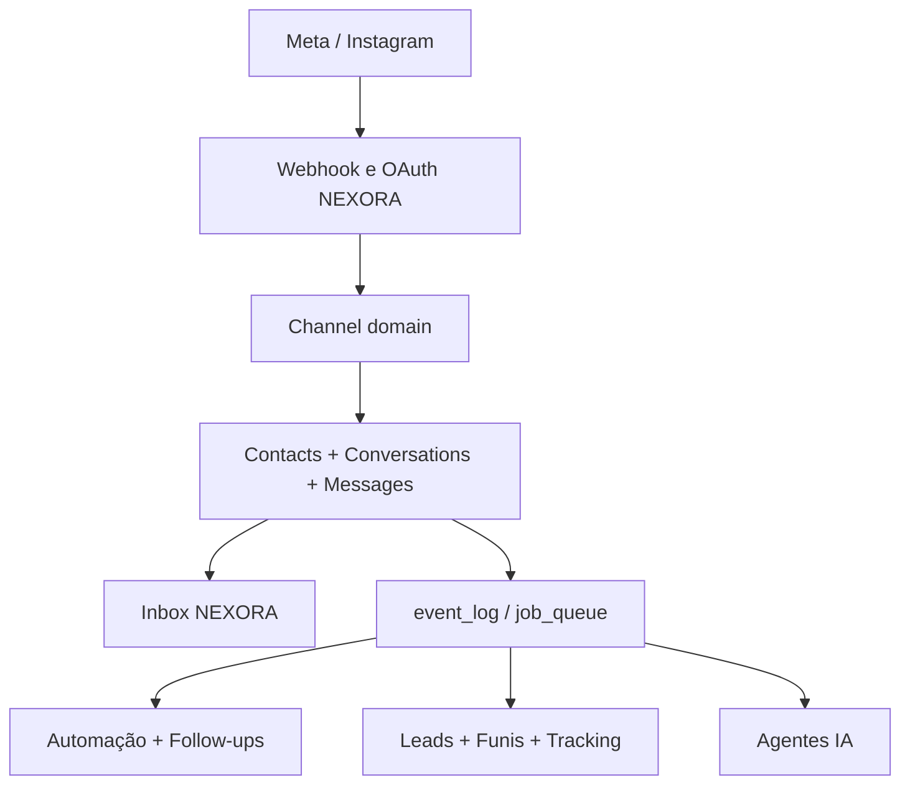
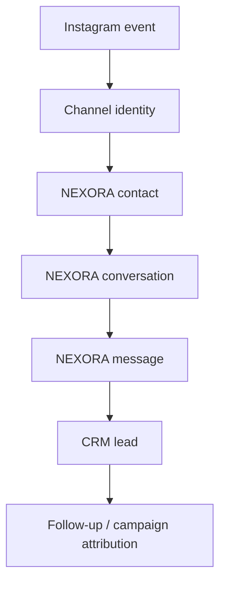

# NEXORA CRM + OpenReply — Arquitetura de Integração

> Documento de arquitetura, sem implementação. Evidência analisada em 2026-09-13 a partir dos arquivos `CRM-setup-local-foundation.zip` (snapshot `08bc880...`) e `openreply-main.zip` (snapshot `f37233f...`).

## 1. Decisão executiva

O NEXORA permanece o único produto, painel, sistema de autenticação, tenant, CRM, Inbox, catálogo de contatos, motor de automação, motor de follow-up e runtime de IA.

O OpenReply não será incorporado como aplicação, subapp ou pasta isolada. Ele será usado como fonte de capacidades Instagram maduras. Essas capacidades serão portadas para os seams já existentes do NEXORA:

- `channel_sessions` e `lib/channels/` para conexão/transporte;
- `contacts`, `conversations` e `messages` para identidade e Inbox;
- `event_log` e os workers NEXORA para trabalho assíncrono;
- `automation_rules` e `automation_rule_runs` para comentário/DM e palavras-chave;
- `followup_flow_*` e `followup_enrollments` para sequências;
- `crm_leads`, `crm_lead_activities` e `crm_lead_links` para funil;
- `ad_*` para atribuição e Meta Ads;
- `ai_agents` e o agent engine para IA.

Não haverá runtime Prisma/Auth.js/BullMQ separado. A integração deve preservar o comportamento maduro do OpenReply, não suas fronteiras arquiteturais.

## 2. Estado observado dos repositórios

### 2.1 NEXORA CRM

| Área | Estado observado |
|---|---|
| Framework | Next.js `16.3.4`, App Router; React `19.2.8`; TypeScript `6.0.3` estrito; Node `>=22`; pnpm `9.15.9` |
| UI | Tailwind `4.3.3`, shadcn/Radix, interface autenticada em `app/app/`, shell e navegação próprios |
| Backend | Route Handlers versionados em `app/api/v1/`; Server Actions; workers próprios |
| Auth | Supabase Auth com `@supabase/ssr`; cookie; `getUser()` server-side; MFA e RBAC por organização |
| Banco | Supabase/PostgreSQL, migrations SQL + `baseline.sql`, tipos gerados em `lib/database.types.ts` |
| Tenancy | `organizations` + `user_organizations`; `organization_id` em entidades tenant-aware; RLS |
| Inbox | `contacts`, `conversations`, `messages`; UI completa em `components/inbox/`; Realtime |
| CRM | pipelines, stages, leads, activities, links, tasks, scoring, risco e Customer 360 |
| Canais | Abstração `ChannelAdapter`; providers atuais `waha`, `meta_cloud` e `zernio`; WhatsApp principal |
| Webhooks | Rotas com path token/HMAC, arquivo operacional em `webhook_events_log` |
| Automação | `automation_rules`, `automation_rule_runs`, condições, ações e motor próprio |
| Follow-up | Fluxos versionados, enrollments, eventos, retries e worker dedicado |
| IA | Agentes, versões, roteadores, memória, RAG, guardrails, pacing, handoff e MCP |
| Filas/jobs | `event_log`, `job_queue`, workers e crons; não usa BullMQ como núcleo |
| Redis | Upstash REST para rate limit/debounce, com fallback em memória em partes do sistema |
| Meta existente | WhatsApp Cloud (`meta_cloud`), templates, Meta Ads Insights e Conversions API |
| Observabilidade | Sentry, logger estruturado, audit log e central operacional |
| Deploy | Self-host em VPS; imagens para app/worker/scheduler; Vercel não cobre sozinho os processos permanentes |

### 2.2 OpenReply

| Área | Estado observado |
|---|---|
| Framework | Next.js `16.2.6`, React `19.2.4`, TypeScript `5`, Node types `20` |
| UI | Tailwind 4, páginas próprias de dashboard/campaigns/inbox/settings |
| Backend | Route Handlers no App Router |
| Auth | Auth.js/NextAuth beta 5 + Prisma Adapter + magic link via Resend/SMTP |
| Banco | Prisma `7.8.0` + PostgreSQL |
| Tenancy | `Workspace`, `WorkspaceMember`, convites e papéis OWNER/ADMIN/MEMBER |
| Instagram | Login oficial do Instagram, token longo, refresh, webhook, insights, posts e inbox |
| Automação | `Automation` concentra configuração de comentário/DM, follow gate, resposta pública e follow-up |
| Queue | BullMQ `5.76.4` + ioredis `5.10.1`, queue `dm-processing` |
| Worker | processo separado `worker/dm-worker.ts` |
| Rate limit | reserva atômica Redis por conta; teto codificado de 750 private replies/h; requeue de 30 min |
| Deduplicação | job IDs determinísticos + unique `(automationId, commentId)` + `PostbackDelivery` |
| Tracking | links rastreados, clicks, CTR e relatórios compartilháveis |
| Providers | Meta direto e Zernio opcional |
| Infra | PostgreSQL, Redis, web app e worker sempre ativo |

## 3. Sobreposições que não podem ser duplicadas

| Capacidade | Fonte canônica após integração |
|---|---|
| Usuário, sessão, MFA | Supabase Auth do NEXORA |
| Tenant | `organizations`/`user_organizations` do NEXORA |
| Canal conectado | `channel_sessions` do NEXORA |
| Pessoa | `contacts` do NEXORA |
| Thread | `conversations` do NEXORA |
| Mensagem | `messages` do NEXORA |
| Inbox | UI e APIs do NEXORA |
| Lead/funil | `crm_*` do NEXORA |
| Automação genérica | `automation_rules` do NEXORA |
| Follow-up | `followup_flow_*` do NEXORA |
| Execução assíncrona | `event_log`/`job_queue`/workers do NEXORA |
| IA | `ai_agents` + agent engine do NEXORA |
| Meta Ads | `ad_platform_connections`, `ad_insights_connections`, `ad_conversion_dispatches` |
| Auditoria/operação | `api_audit_log`, `webhook_events_log`, Sentry e central do NEXORA |

## 4. Arquitetura-alvo



### 4.1 Navegação única

```text
NEXORA
├── Atendimento
│   └── Inbox
│       ├── Todos
│       ├── WhatsApp
│       ├── Instagram
│       └── Facebook (fase futura, contrato já extensível)
├── CRM
│   ├── Funis
│   ├── Contatos
│   └── Tarefas
├── Automação
│   ├── Regras
│   ├── Comentário → DM
│   ├── DM/Story → resposta
│   ├── Follow-ups
│   └── Campanhas
├── Agentes IA
├── Meta Ads
└── Configurações
    └── Canais e integrações
```

As novas telas devem ser registradas em `lib/navigation/registry.ts`. Não criar shell, sidebar ou layout do OpenReply.

### 4.2 Fluxo de identidade e CRM



Regras:

1. Um IGSID/Instagram user ID é identidade externa, não um contato paralelo.
2. A identidade resolve ou cria exatamente um `contact` ativo na organização.
3. A combinação organização + sessão Instagram + identidade externa resolve uma `conversation` NEXORA.
4. DMs entram em `messages`; comentários entram no arquivo de eventos e só viram mensagem da Inbox quando fazem parte de uma interação conversacional escolhida pelo produto.
5. A cadeia comum `aplicarEfeitosPosEntrada()` deve ser reutilizada após a persistência inbound: opt-out, lead, campanha, follow-up e agente.

## 5. Boundaries de backend

### 5.1 Edge HTTP

- OAuth: `app/api/v1/channels/instagram/connect` e `callback`.
- Verificação do webhook: GET na rota pública canônica da Meta.
- Recepção: POST lendo `rawBody` uma única vez e validando `x-hub-signature-256` antes de JSON parse/persistência operacional.
- Resposta à Meta deve ser rápida; o request apenas autentica, valida envelope mínimo, arquiva/idempotentiza e emite evento.

### 5.2 Domínio Instagram

Criar um subdomínio coerente com o NEXORA, por exemplo `lib/channels/instagram/`, com:

- `oauth-state.ts`: nonce de uso único, expiração e vínculo com organização/usuário;
- `oauth-client.ts`: exchange, long-lived token, refresh e revoke;
- `credentials.ts`: cifra/decifra usando as RPCs canônicas NEXORA;
- `webhook.ts`: assinatura e parsers puros;
- `envelope.ts`: normalização para eventos internos;
- `ingest.ts`: upsert de identidade/contato/conversa/mensagem;
- `adapter.ts`: envio/reply do canal, sem regras de negócio;
- `rate-limit.ts`: bucket atômico por conta e operação;
- `reconcile-comments.ts`: recuperação estreita para falhas de entrega de webhook.

### 5.3 Trabalho assíncrono

Não importar BullMQ. Traduzir seus jobs para eventos NEXORA:

| OpenReply job | Evento/worker NEXORA proposto |
|---|---|
| `process-comment` | `instagram.comment.received` → handler de automação |
| `process-message` | `message.received` já canônico, com `channel=instagram` |
| `process-postback` | `instagram.postback.received` |
| `process-followup` | enrollment no motor de follow-up existente |
| token refresh cron | cron NEXORA específico que emite alerta operacional em falha |
| comment reconciler | cron estreito, cursorado e rate-aware |

Use leases/claims e `next_attempt_at` do ecossistema NEXORA. Cada side effect precisa de idempotency key persistente, não apenas retenção temporária da fila.

## 6. Reuso dos algoritmos do OpenReply

Portar com atribuição e testes de comportamento:

- scopes e fluxo oficial Instagram Login;
- troca por token de longa duração e refresh;
- subscription da conta aos campos de webhook;
- parsing de comments, messages, postbacks e read receipts;
- tratamento de `original_media_id` para posts impulsionados;
- filtro de self-comment e echoes;
- keyword matching Unicode/whole-word;
- follow gate e fallback do opening DM;
- tracked buttons/links;
- reserva Redis atômica para limite por conta;
- IDs determinísticos para comentário, mensagem, postback e follow-up;
- separação de resultado da resposta pública e da DM;
- reconciliação estreita de comentários.

Não portar o código sem adaptar suas suposições de tenant, ORM, auth, nomes, logs e persistência.

## 7. Infraestrutura alvo

### Obrigatória

- app NEXORA;
- Supabase/PostgreSQL;
- processo worker NEXORA;
- scheduler/cron NEXORA;
- URL HTTPS pública estável;
- app Meta com Instagram Login e permissões aprovadas;
- chave mestre de criptografia já usada pelo NEXORA.

### Redis

O NEXORA usa Upstash REST; o OpenReply usa Redis TCP exigido pelo BullMQ. Como BullMQ será descartado, não adicionar Redis TCP apenas para esta integração. O rate limit Instagram deve usar o backend Redis canônico do NEXORA com operação atômica compatível. Se a API REST não fornecer a atomicidade necessária no desenho escolhido, usar script/transaction suportado ou mover o ledger crítico para Postgres; não degradar silenciosamente para memória em produção multi-instância.

## 8. Decisões arquiteturais formais

1. **NEXORA owns the core:** entidades e UX centrais nunca vêm do OpenReply.
2. **Capability port, not app merge:** portar comportamento, não importar aplicação.
3. **Um único banco:** PostgreSQL/Supabase NEXORA.
4. **Um único tenant:** `organization_id`; `Workspace` é descartado.
5. **Uma única Inbox:** dados Instagram entram nas tabelas NEXORA.
6. **Um motor assíncrono:** `event_log`/workers; BullMQ não entra.
7. **Um motor de follow-up:** OpenReply apenas fornece semântica de gatilho/ação.
8. **Secrets server-only:** tokens cifrados, nunca devolvidos à UI.
9. **Provider separado:** Instagram não deve ser chamado de `meta_cloud`, que no NEXORA significa WhatsApp Cloud.
10. **Licença preservada:** código portado retém os avisos MIT de Anish Raj e Diwen Huang; NEXORA não reivindica autoria original.

## 9. Riscos principais

- Misturar WhatsApp Cloud e Instagram sob o mesmo valor `meta_cloud`.
- Criar segundo perfil/contato ao invés de identidade externa vinculada.
- Processar webhook síncrono até o envio e estourar timeout/retry da Meta.
- Confiar apenas no job ID temporário e reenviar DM após poda da fila.
- Guardar access token em JSON/metadata ou frontend.
- Usar service role sem `organization_id` explícito.
- Portar o teto de 750/h como verdade eterna; deve ser configurável e validado contra a política vigente da Meta antes do go-live.
- Tratar reply de Story como evento específico quando ele chega no stream de mensagens.
- Duplicar campanhas/follow-ups que o NEXORA já modela.
- Rodar worker permanente na Vercel: o deploy self-host precisa manter app + worker + scheduler.

## 10. Fora de escopo desta análise

- qualquer alteração de código ou schema;
- configuração real de app Meta;
- pedido de permissões/App Review;
- migração de dados de uma instalação OpenReply já em uso;
- Facebook Messenger completo, apesar de a arquitetura permitir extensão futura;
- validação dinâmica de limites/documentação Meta, que deve ocorrer na fase de implementação.
